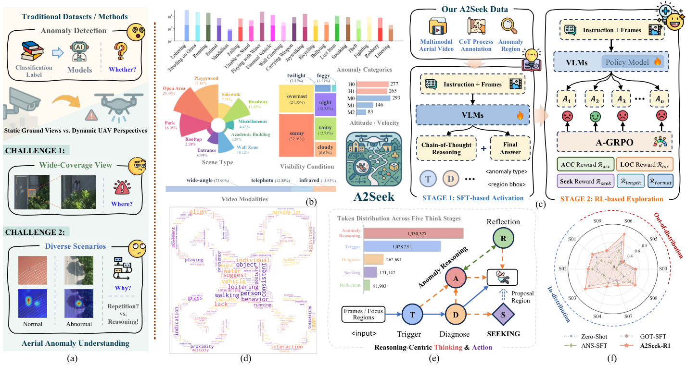

# A2Seek

Training, inference and evaluation for aerial anomaly understanding.

[Paper](https://arxiv.org/abs/2505.21962) · [Project](https://2-mo.github.io/A2Seek/) · [中文](README.zh-CN.md)

[](docs/static/images/overview.png)

*Overview of A2Seek (Figure 1 from the paper).*

Run commands from the repository root. Training and inference require Linux and an NVIDIA GPU.

| Resource | Hugging Face repository | Local directory |
| --- | --- | --- |
| Dataset: annotations and images | [tiu2mo/A2Seek](https://huggingface.co/datasets/tiu2mo/A2Seek) | `data/A2Seek/` |
| Final 3B model | [tiu2mo/A2Seek-R1-3B](https://huggingface.co/tiu2mo/A2Seek-R1-3B) | `models/A2Seek-R1-3B/` |
| Final 7B model | [tiu2mo/A2Seek-R1-7B](https://huggingface.co/tiu2mo/A2Seek-R1-7B) | `models/A2Seek-R1-7B/` |

## 1. Install the environment

Install [uv](https://docs.astral.sh/uv/getting-started/installation/) if needed:

```bash
curl -LsSf https://astral.sh/uv/install.sh | sh
export PATH="$HOME/.local/bin:$PATH"
```

Create the environment and install the locked dependencies:

```bash
uv python install 3.12
uv sync --locked --extra train --extra dataset
```

## 2. Download the dataset

```bash
uv run --no-sync hf download tiu2mo/A2Seek \
  --repo-type dataset --local-dir data/A2Seek
uv run --no-sync python scripts/data/materialize_images.py
```

The second command restores images to `data/A2Seek/images/`.

Saved sample ID lists are in `data/A2Seek/metadata/splits/`. `metadata/domain_protocol.json` records their checksums, counts and scene codes:

| Setting | ID list | Samples | Scenes |
| --- | --- | ---: | --- |
| ID training | `train.txt` / `id_train.txt` | 3,489 | 01, 02, 03, 04, 07, 08 |
| ID evaluation | `validation.txt` / `id_eval.txt` | 2,327 | 01, 02, 03, 04, 07, 08 |
| OOD evaluation | `test.txt` / `ood_eval.txt` | 2,376 | 00, 05, 06, 09 |

These lists preserve the saved annotations' membership and order. Train and validation are disjoint by sample and share 383 videos.

`metadata/video_annotation_index.jsonl` maps each encoded clip ID, such as `video_group_001/video_1`, to its annotation filename, attribute code, frame directory, training images and original DJI filename. The pair (`video_group`, `video_name`) identifies a clip; the attribute code describes its event and environment and can be shared by several clips.

`metadata/dji_clip_mapping.jsonl` provides the 542 wide-camera video correspondences, verified by frame counts and image content. `metadata/dji_video_group_mapping.jsonl` indexes all 1,616 original captures: `verified_clip` identifies the annotated W stream, `paired_capture` identifies a Z/T/S stream sharing its capture directory and DJI timestamp/sequence, and `group_candidate` preserves additional group-level captures. Companion streams have their own views and frame timing. Original videos remain separate from the image release.

## 3. Download the model weights

Download the default 3B model:

```bash
uv run --no-sync hf download tiu2mo/A2Seek-R1-3B \
  --local-dir models/A2Seek-R1-3B
```

To use the 7B model instead, run:

```bash
uv run --no-sync hf download tiu2mo/A2Seek-R1-7B \
  --local-dir models/A2Seek-R1-7B
```

For 7B inference, add `--model models/A2Seek-R1-7B`.

## 4. Run inference

```bash
uv run --no-sync python scripts/infer.py \
  --data data/A2Seek/dataset/cot_single_reflection/test.jsonl \
  --output outputs/test-predictions.jsonl \
  --gpus 0 --batch-size 1
```

Add `--limit 8` for a quick check or `--resume` to continue.

Answer and seeking boxes use input-image pixel coordinates `[x1, y1, x2, y2]`, representing the top-left and bottom-right corners.

For the unadapted Qwen zero-shot baseline:

```bash
uv run --no-sync python scripts/infer.py \
  --preset zero_shot_3b --output outputs/zero-shot-test.jsonl --gpus 0
uv run --no-sync python scripts/evaluate.py \
  --predictions outputs/zero-shot-test.jsonl \
  --references data/A2Seek/dataset/cot_single/test.jsonl \
  --label-aliases src/a2seek/configs/evaluation/label_aliases.json \
  --output outputs/zero-shot-test-metrics.json
```

Use `--preset zero_shot_7b` for the 7B base model, or `--model /path/to/base-model` for a local copy. The presets use `cot_single/test.jsonl`, greedy decoding and 2,048 generated tokens, without a LoRA adapter. For ID evaluation, add `--data data/A2Seek/dataset/cot_single/validation.jsonl`. The exact user prompt is included in `src/a2seek/prompts/zero_shot.txt`; configurations are in `src/a2seek/configs/inference/`. Evaluate these predictions with the corresponding `cot_single` annotation file.

## 5. Evaluate predictions

```bash
uv run --no-sync python scripts/evaluate.py \
  --predictions outputs/test-predictions.jsonl \
  --references data/A2Seek/dataset/cot_single_reflection/test.jsonl \
  --label-aliases src/a2seek/configs/evaluation/label_aliases.json \
  --output outputs/test-metrics.json
```

`--references` checks that the complete split is present and its annotation targets are unchanged. Omit it for a small smoke-test subset. `--label-aliases` normalizes equivalent category names in predictions and references. Reports keep sample averages (`first_category_accuracy`, `mean_first_box_iou`) and scene averages (`scene_macro_first_category_accuracy`, `scene_macro_mean_first_box_iou`) separate. IoU includes samples with a nonzero reference box; scenes without localization targets are excluded from the scene IoU average. Evaluate validation and test with their corresponding annotation files.

## 6. Train

### Prepare training inputs

```bash
uv run --no-sync python scripts/data/prepare_local_data.py
```

### SFT

```bash
uv run --no-sync python scripts/train.py \
  --preset sft_3b --gpus 0 --output outputs/sft
```

SFT starts from `Qwen/Qwen2.5-VL-3B-Instruct`. Use `--model /path/to/base-model` for a local copy, or `--preset sft_7b` for 7B.

### GRPO

Replace `/path/to/sft/checkpoint` with a saved SFT checkpoint, then merge and train:

```bash
uv run --no-sync swift export \
  --adapters /path/to/sft/checkpoint \
  --merge_lora true --use_hf true --output_dir outputs/sft-merged
uv run --no-sync python scripts/train.py \
  --preset grpo --model outputs/sft-merged \
  --gpus 0 --output outputs/grpo
```

After GRPO, merge its adapter with `swift export` and pass the merged directory to `scripts/infer.py --model`.

## Project structure

```text
data/A2Seek/             Dataset and restored images
models/
  A2Seek-R1-3B/           Default inference model
  A2Seek-R1-7B/           Optional 7B model
outputs/                 Predictions, metrics and training checkpoints
scripts/
  train.py               Training command
  infer.py               Inference command
  evaluate.py            Evaluation command
  data/                  Restore images and prepare training inputs
src/a2seek/              Implementation and training presets
docs/
  index.html             Project website (GitHub Pages)
  static/                Website images, videos, styles and scripts
```

Keep each downloaded repository's directory structure intact. `data/`, `models/` and `outputs/` are ignored by Git.

For inference and data preparation at other locations, specify `--dataset-root` and `--model` where applicable, and update inference's `--data` path accordingly.

GitHub Pages: deploy the `main` branch's `/docs` folder.

## Citation and licenses

If you find A2Seek helpful, we'd appreciate a ⭐ Star or a citation to our paper:

```bibtex
@inproceedings{NEURIPS2025_de02de51,
 author = {Mo, Mengjingcheng and Tong, Xinyang and Tan, Mingpi and Leng, Jiaxu and Zheng, JianKang and Liu, Yiran and Chen, Haosheng and Gan, Ji and Li, Weisheng and Gao, Xinbo},
 booktitle = {Advances in Neural Information Processing Systems},
 doi = {10.52202/085713-5057},
 editor = {D. Belgrave and C. Zhang and H. Lin and R. Pascanu and P. Koniusz and M. Ghassemi and N. Chen},
 publisher = {Curran Associates, Inc.},
 title = {A2Seek: Towards Reasoning-Centric Benchmark for Aerial Anomaly Understanding},
 url = {https://proceedings.neurips.cc/paper_files/paper/2025/file/de02de513503962e1d21035ab50ce661-Paper-Datasets_and_Benchmarks_Track.pdf},
 volume = {38, Main Conference},
 year = {2025}
}
```

Main dependency licenses:

- **Apache-2.0**: ms-swift, Transformers, PEFT, TRL, qwen-vl-utils, Datasets, PyArrow and huggingface_hub.
- **BSD-3-Clause**: PyTorch and torchvision.

Released model weights and loading assets follow the included `LICENSE` and `NOTICE` files.
